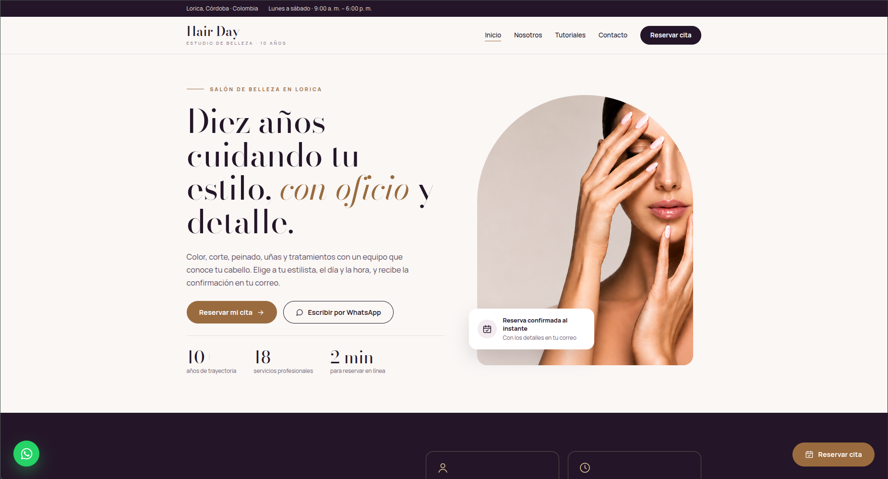
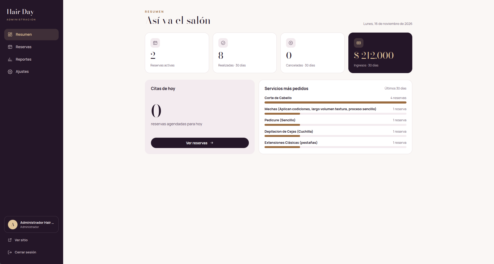

# Hair Day · Reservas en línea para salón de belleza

**En vivo:** [reservapelu.com](https://[reservapelu.com]) · **En uso real desde:** mediados de 2026

> El código fuente es privado porque maneja datos de clientas reales. Con gusto lo muestro en una entrevista.

## El problema

El salón agendaba todas sus citas por WhatsApp y llamadas. Había citas cruzadas, mensajes a cualquier hora y mucho tiempo perdido respondiendo las mismas preguntas.

## La solución

Una aplicación web donde la clienta elige el servicio, el día y la hora, y reserva sola. La estilista ve y administra todas las citas desde un panel.

## Qué hice

Todo el ciclo, solo: levanté los requerimientos con la dueña del negocio, diseñé la base de datos, programé el frontend y el backend, y lo desplegué en producción con dominio propio.

## Stack

| Capa | Tecnología |
| --- | --- |
| Frontend | React, Vite |
| Backend | Node.js, Express, API REST |
| Base de datos | PostgreSQL |
| Despliegue | Vercel (frontend), Railway (API y base de datos), Hostinger (dominio) |

## Funcionalidades

- Reserva en línea sin llamar ni escribir.
- Autenticación y panel de administración para gestionar citas.
- [Agrega aquí otras: cancelaciones, horarios bloqueados, recordatorios, etc.]

## Lo que falló y cómo lo resolví

**Caídas de conexión en producción.** La API perdía la conexión con PostgreSQL en Railway y las reservas fallaban. Lo resolví con connection pooling, para reutilizar conexiones en vez de abrir una nueva en cada petición.

**Dominio propio para la API.** Configuré registros CNAME en Hostinger para servir la API en `api.reservapelu.com`.

## Capturas

| Reserva | Panel de la estilista |
| --- | --- |
|  |  |

[Ver video demo](docs/reserva-estetica.mp4)

---

Hecho por **Edinson Rivera** · [Portafolio](https://[tu-portafolio]) · [LinkedIn](https://www.linkedin.com/in/edinson-rivera-dev)